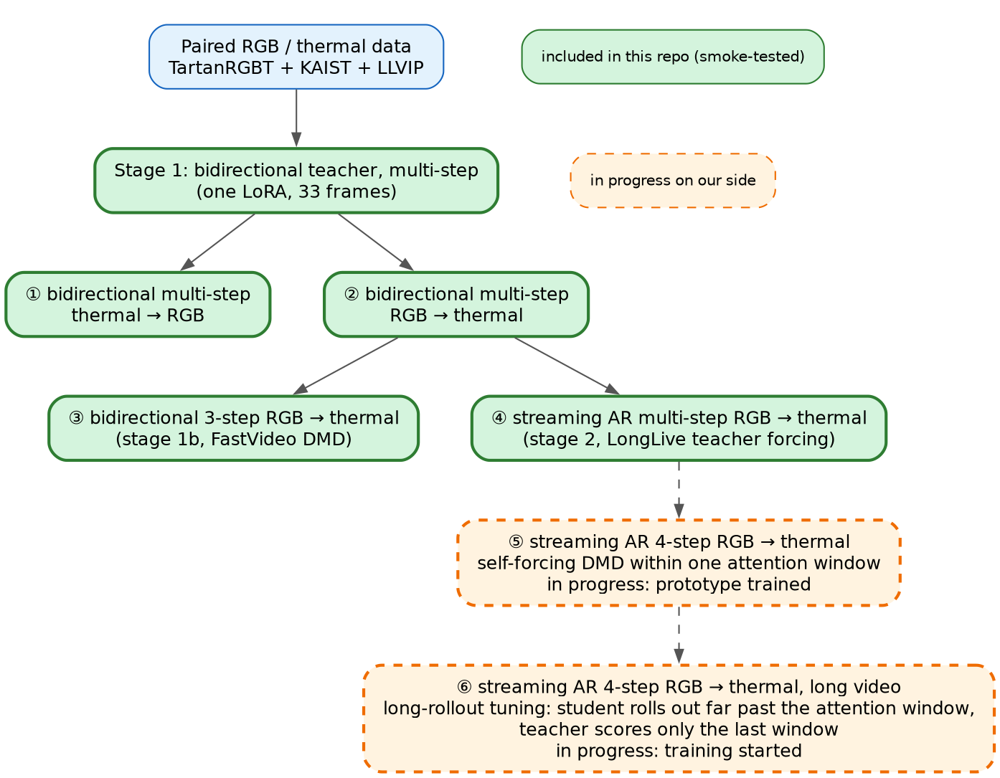

# thermal_v2v

RGB ↔ passive-thermal (LWIR) video translation with a video diffusion transformer (Wan2.2-TI2V-5B), plus a streaming
(autoregressive) RGB → thermal model.

**Running this with an AI coding agent?** Point it at [`AGENTS.md`](AGENTS.md): it is a step-by-step runbook with a
check after every step and a list of what to report back.

The model is conditioned in-context, by token concatenation: the clean condition video and the noisy target video
form one token sequence and share 3D RoPE positions. There is no ControlNet and no VACE.

Model tree. Solid green: included in this repository and smoke-tested end to end. Dashed orange: in progress on our
side, not part of this hand-off.



(Source: `assets/model_tree.dot`; render with graphviz `dot -Tpng`.)

① and ② come from the same stage-1 LoRA; the task sentence of the caption selects the direction. ① ends there.

③ and ④ start from the merged rgb→thermal view of that LoRA:
- stages 1 and 1b use all three sources (33-frame clips; LLVIP stills as static clips);
- stage 2 uses the video sources only (TartanRGBT + KAIST, 81-frame clips).

"Smoke-tested" means the full chain ran on one GPU with a few clips per source. Full-scale runs and their quality
are not verified yet.

The few-step streaming model continues from ④ in two steps, both still in progress on our side and not part of this
hand-off:
- **⑤ Self-forcing DMD (rollouts within one attention window).**
  - The student rolls out with its own history.
  - A fresh LoRA is distilled from the bidirectional teacher.
  - Prototype: single-direction plain-LoRA teacher, TartanRGBT only, 1×H200. At step 100 it reached the 30-step AR
    quality at 4 steps on 8 val clips, then plateaued lower.
- **⑥ Long-rollout tuning of the same LoRA.**
  - The student rolls out far beyond the attention window (rolling KV cache + a 1-pair frame sink), and the teacher
    scores only the last 21 pairs.
  - This targets the slow wash-out seen over minute-long streams.
  - Training has just started.

The code for both is in the LongLive patch (`configs/thermal/train_dmd_r2t_own.yaml`, `train_dmd_r2t_long.yaml`). The
recipe is not fixed yet.

Deliverables of this hand-off:

| # | Model | Stage | Code |
|---|---|---|---|
| ① | bidirectional, multi-step, **thermal→rgb** | 1 | `src/train_icl.py` (this repo) |
| ② | bidirectional, multi-step, **rgb→thermal** (same LoRA as ①, other task sentence) | 1 | same |
| ③ | bidirectional, **3-step** rgb→thermal | 1b | hao-ai-lab/FastVideo + `scripts/stage1b/fastvideo_thermal_icl.patch` |
| ④ | streaming (autoregressive), multi-step rgb→thermal | 2 | NVlabs/LongLive 2.0 + `scripts/stage2/longlive_thermal_v2v.patch` |

- **Stage 1:** one LoRA for rgb→thermal, thermal→rgb and joint generation, on 33-frame clips.
- **Stage 1b:** distils the stage-1 teacher (rgb→thermal) into a 3-step student. This is the phase-1 recipe that
  matched the 30-step CFG teacher.
- **Stage 2:** makes the teacher causal and autoregressive with teacher forcing. Frames are interleaved
  `[RGB_0, T_0, RGB_1, T_1, …]`, with 4 video frames per chunk.

Few-step streaming (self-forcing DMD) and long-rollout tuning live in the same LongLive patch. They are still
experimental and are not part of this hand-off.

---

## 1. Layout

```
configs/stage1/bidir_33f.yaml        stage-1 training config (paths from the environment)
configs/data/*.txt                   TartanRGBT sequence lists (train 34 / val 4 / download list)
datasets/captions.py                 structured captions (task + thermal style + video/still)
datasets/rgbt_sources.py             TartanRGBT / KAIST / LLVIP readers -> one paired-clip format
models/icl/                          Wan2.2 ICL transformer, (gated) LoRA
src/precompute_latents.py            raw clips -> Wan2.2 VAE latents (one safetensors per clip)
src/train_icl.py, src/infer_icl.py   stage-1 training / evaluation
scripts/env.sh                       ALL paths and env names: edit once, `source` before everything
scripts/setup/create_envs.sh         conda env for stage 1 + data
scripts/data/download_*.{py,sh}      dataset downloads from the official sources
scripts/data/encode_all.sh           encode every latent set (multi-GPU, resumable)
scripts/stage1/{train,eval}.sh
scripts/stage1b/setup_fastvideo.sh   FastVideo checkout + patch + conda env
scripts/stage1b/merge_teacher.py     stage-1 checkpoint -> merged diffusers teacher (rgb2thermal view)
scripts/stage1b/latents_to_parquet.py  33f latents (mixed by source weight, per-clip captions) -> FastVideo parquet
scripts/stage1b/{train_dmd,eval}.sh
scripts/stage2/setup_longlive.sh     LongLive checkout + patch + conda env + Wan2.2 original-format files
scripts/stage2/export_teacher.py     stage-1 checkpoint -> merged, LongLive-format teacher
scripts/stage2/{train_ar,eval_ar}.sh
scripts/smoke_test.sh                one-GPU end-to-end check (~1 h)
```

## 2. Setup

Requirements: Linux, NVIDIA GPUs with ≥ 80 GB memory (H100/H200/H20 tested on Hopper-class), and a driver that
supports CUDA 12.8. You also need conda and internet access, for pip, Hugging Face and Google Drive.

```bash
git clone https://github.com/Greenery-S/thermal_v2v.git && cd thermal_v2v
vim scripts/env.sh                  # set WAN22_5B_DIR, THERMAL_DATA, THERMAL_RUNS (and conda env names if you like)
source scripts/env.sh
bash scripts/setup/create_envs.sh   # conda env for stage 1 + data
huggingface-cli download Wan-AI/Wan2.2-TI2V-5B-Diffusers --local-dir "$WAN22_5B_DIR"
bash scripts/stage1b/setup_fastvideo.sh # FastVideo @ pinned commit + patch, its conda env
bash scripts/stage2/setup_longlive.sh   # LongLive @ pinned commit + patch, its conda env, Wan2.2 VAE/tokenizer
```

Every later step assumes `source scripts/env.sh` in the current shell.

## 3. Data

Three paired RGB/thermal sources. All are aligned pixel-to-pixel. Each is center-cropped to 5:4 and resized to
640×512. Thermal is normalised per clip with percentiles, never per frame.

| Source | Form | Thermal | Clips (33f) | Sampling weight | License |
|---|---|---|---|---|---|
| [TartanRGBT](https://huggingface.co/datasets/theairlabcmu/TartanRGBT) | video, 10 Hz | 16-bit radiometric | ~7.8k | 0.6 | see dataset card |
| [KAIST Multispectral](https://github.com/SoonminHwang/rgbt-ped-detection) | video, 20 Hz → 10 Hz | 8-bit auto-gain | ~3k | 0.25 | CC BY-NC-SA 4.0 |
| [LLVIP](https://github.com/bupt-ai-cz/LLVIP) | still images → static clips | 8-bit auto-gain | ~2.4k (every 5th image) | 0.15 | non-commercial research |

The datasets are not redistributed. Download them from the official sources (~350 GB on disk after extraction).
No accounts are needed: every source is public, including the Hugging Face repos and the Google Drive links. With a
Hugging Face token (`huggingface-cli login` or `HF_TOKEN`), the ~300 GB TartanRGBT download is less likely to be
rate-limited. The scripts retry and resume either way.

```bash
python scripts/data/download_tartanrgbt.py --out $THERMAL_DATA/raw/TartanRGBT \
    --sequences_file configs/data/tartanrgbt_download.txt --delete_zips      # 38 sequences, ~300 GB
bash scripts/data/download_kaist.sh $THERMAL_DATA/raw/KAIST                   # official Drive tar, 39 GB (+ extracted)
bash scripts/data/download_llvip.sh $THERMAL_DATA/raw/LLVIP                   # 4 GB
```

Then encode the latents. One process runs per GPU and the step is resumable. For multi-node runs, set
`NNODES` / `NODE_RANK`.

```bash
bash scripts/data/encode_all.sh stage1   # 33-frame latents: tartanrgbt_33f/{train,val}, kaist_33f, llvip_33f
bash scripts/data/encode_all.sh stage2   # 81-frame video latents: tartanrgbt_81f/{train,val}, kaist_81f
```

### Captions

Captions are fixed-order English sentences in the descriptive style Wan2.2 was trained on (`datasets/captions.py`).
They are chosen per clip from the latent's metadata:

```
A thermal infrared video converted from an RGB video.      <- task (rgb2thermal | thermal2rgb | joint)
Captured by a radiometric thermal camera.                   <- thermal "style": radiometric (TartanRGBT) | 8-bit auto-gain
Consecutive frames from a real video.                       <- or: A single still image repeated over time.
```

The thermal-style sentence lets the 8-bit auto-gain sources add scene diversity without mixing their per-frame
auto-contrast look into the radiometric output. At inference, use the radiometric caption for TartanRGBT-style
output. In training, only the whole caption is dropped (10 %, for classifier-free guidance). Scene or event
sentences can be appended later without changing the existing ones.

## 4. Stage 1: bidirectional teacher

```bash
bash scripts/stage1/train.sh                      # all local GPUs; multi-node: NNODES NODE_RANK MASTER_ADDR MASTER_PORT
bash scripts/stage1/eval.sh step_3000.pt rgb2thermal
bash scripts/stage1/eval.sh step_3000.pt thermal2rgb
```

Config: `configs/stage1/bidir_33f.yaml`
- LoRA r64 on Wan2.2-TI2V-5B.
- Directions are sampled 0.45 / 0.45 / 0.1 (rgb2thermal / thermal2rgb / joint).
- lr 1e-4, condition and caption dropout 0.1.
- `batch_size` is **per GPU** (2 × 32 GPUs = global 64).
- Validation runs every 250 steps. Pick the step by val loss and the eval metrics.

`model.lora.gating: all` is a plain LoRA, the same on every token. Stage 2 requires it, because it merges the LoRA
into the base weights. `gated` gives each modality its own LoRA, applied only to the stream being generated (the
UniVidX recipe). It cannot be merged.

## 5. Stage 1b: 3-step bidirectional rgb → thermal (FastVideo DMD)

```bash
python scripts/stage1b/merge_teacher.py --run_dir $THERMAL_RUNS/stage1_bidir_33f --ckpt step_3000.pt \
    --out $THERMAL_RUNS/stage1b_teacher/Wan2.2-TI2V-5B-Diffusers
$PY_FV scripts/stage1b/latents_to_parquet.py --prompt_embeds $THERMAL_RUNS/stage1_bidir_33f/prompt_embeds.pt \
    --src $THERMAL_DATA/latents/tartanrgbt_33f/train:0.6 --src $THERMAL_DATA/latents/kaist_33f/train:0.25 \
    --src $THERMAL_DATA/latents/llvip_33f/train:0.15 --out $THERMAL_DATA/fastvideo/rgb2thermal_33f/train
bash scripts/stage1b/train_dmd.sh          # all local GPUs; checkpoints every 250 steps
bash scripts/stage1b/eval.sh 3000          # 3-step student (EMA), no CFG; compare with scripts/stage1/eval.sh (30 steps, CFG 2)
```

- **Init:** the student, real score and fake score all start from the merged teacher.
- **Recipe:**
  - LoRA r32, lr 1e-4;
  - one generator update per 5 critic updates;
  - EMA from step 0;
  - student timesteps 1000/757/522;
  - real-score guidance 1.0 (= CFG 2 on the condition video);
  - no GAN.
- **Phase-1 reference** (17 frames, TartanRGBT): the EMA student at 1k–3k steps matched or beat the 30-step CFG
  teacher on PSNR/SSIM/LPIPS, at 1/19 of the latency.

## 6. Stage 2: streaming RGB → thermal (autoregressive, teacher forcing)

```bash
python scripts/stage2/export_teacher.py --run_dir $THERMAL_RUNS/stage1_bidir_33f --ckpt step_3000.pt \
    --out $THERMAL_RUNS/stage2_teacher             # merged LoRA, LongLive (original Wan) key layout + caption cache
bash scripts/stage2/train_ar.sh stage2_ar          # configs/thermal/stage2_ar.yaml inside the LongLive checkout
bash scripts/stage2/eval_ar.sh $THERMAL_RUNS/stage2_ar/eval_s2000 \
    $THERMAL_RUNS/stage2_ar/checkpoint_model_002000/model.pt --steps 30 --n 8
INFER_CFG=configs/thermal/stage2_infer_bidir.yaml \
    bash scripts/stage2/eval_ar.sh $THERMAL_RUNS/stage2_ar/eval_teacher_bidir   # bidirectional reference
```

- **Layout:** interleaved RGB/thermal latent frames. RGB_i and T_i share RoPE position i, and each gets its own
  modality embedding. RGB frames are clean (t=0) and are not in the loss.
- **Training:** teacher forcing with error recycling (LongLive), 81-frame clips (21 RGB/thermal pairs), EMA 0.99.
- **Data:** TartanRGBT + KAIST video latents. Still images are excluded, because they would teach the AR model
  frozen motion.
- **Eval:** `eval_ar.sh` writes RGB | prediction | real mp4s and `metrics.json`:
  - `pearson_gt`;
  - affine-aligned PSNR/SSIM and the gain over a constant prediction;
  - `jump_ratio`: frame difference at 4-frame chunk boundaries ÷ within chunks. Real thermal is ~1.02. Values
    well above 1 mean visible chunk seams.

Reference from the Hopper prototype (single-direction teacher, TartanRGBT only, 1×H200, step 2000):
- streaming 30 steps: pearson 0.69, jump ratio 1.00;
- bidirectional teacher: pearson 0.72.

## 7. Monitoring: wandb, local logs, in-training eval videos

All three training stages log the same way:

- **wandb.** The default project is `thermal_v2v`; override it with `WANDB_PROJECT` / `WANDB_ENTITY`.
  - The run is online when `WANDB_API_KEY` is set or you are logged in.
  - Otherwise it runs offline inside the run directory; upload it later with `wandb sync <run>/.../wandb/offline-run-*`.
  - One run id per run directory, so restarts and resumes continue the same curves.
- **Local logs in the run directory:**
  - `console.log`: full stdout/stderr;
  - `train_log.jsonl`: per-step losses, the same numbers as wandb;
  - `eval/eval_log.jsonl`: one line per eval clip with its metrics.
- **In-training eval videos.** An eval runs every 60 minutes of wall-clock time, plus once right at the start as the
  step-0 baseline. It uses the current weights on fixed val clips and writes
  `eval/step_XXXXXX/<task>/clipN.mp4` ([condition | prediction | real]). It also logs the video and the metrics to
  wandb at that step:
  - `pearson`;
  - `psnr_affine` / `ssim_affine`: per-clip scale/shift-aligned, because the absolute temperature range of a clip
    is not predictable from RGB;
  - `gain_db`: improvement over predicting the clip mean;
  - `jump_ratio`: chunk-seam indicator, ~1 is good.

| Stage | Eval videos | Change the interval with |
|---|---|---|
| 1 | rgb→thermal + thermal→rgb, 2 clips each, 30 steps, CFG 2 | `training.eval_every_minutes` (config / CLI override) |
| 1b | rgb→thermal, 2 clips, the student's 3 steps | `THERMAL_EVAL_MINUTES`, `THERMAL_EVAL_N` |
| 2 | streaming rgb→thermal, 2 clips, 30 steps | `thermal_eval_minutes`, `thermal_eval_n` in the config |

## 8. Smoke test (do this first on a new cluster)

```bash
bash scripts/smoke_test.sh                 # 1 GPU, a few clips per source, ~1.5 h; outputs under $THERMAL_RUNS/smoke
SMOKE_STEPS="data 1" bash scripts/smoke_test.sh    # or only some parts: data 1 1b 2
```

It runs the whole chain:
1. encode;
2. stage 1 for 20 steps;
3. stage-1 eval in both directions;
4. stage 1b: merge the teacher, build the parquet, train 10 DMD steps, run the 3-step eval;
5. export the teacher for stage 2;
6. stage 2 for 10 iterations (no checkpoint: a full stage-2 checkpoint is ~50 GB);
7. stage-2 streaming eval.

It only checks the plumbing, not the quality. It fails unless every training stage has written its in-training eval
mp4 and its `eval_log.jsonl`.

## 9. Notes / known pitfalls

- **Storage:**
  - raw data ~350 GB;
  - latents ~30 GB;
  - stage-1 checkpoints are small (LoRA only);
  - stage-2 checkpoints are ~50 GB each (full model + EMA; `max_checkpoints` keeps one, `snapshots/` keeps the
    last three EMA weights).
- **LongLive patch fixes.** Upstream behaviour that matters for interleaved inputs:
  - inference used to reset the shared-position RoPE offset (RGB_i / T_i at 2i / 2i+1);
  - self-forcing rollouts restored attention settings before the checkpointed backward;
  - KV-cache compaction for long rollouts.

  These are fixed in the patch. Do not use an unpatched LongLive.
- **torch.compile / triton caches** must be on a filesystem that allows exec (`TORCHINDUCTOR_CACHE_DIR`,
  `TRITON_CACHE_DIR` in `env.sh`).
- **Shared-filesystem locking:** on some NFS mounts `flock` hangs. Set `HDF5_USE_FILE_LOCKING=FALSE` (done in
  `env.sh`) and keep `HF_HOME` on a local or lock-capable disk.
